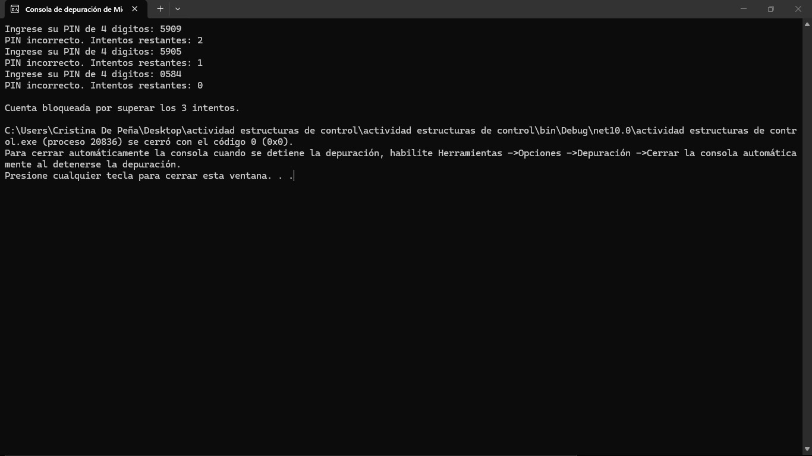
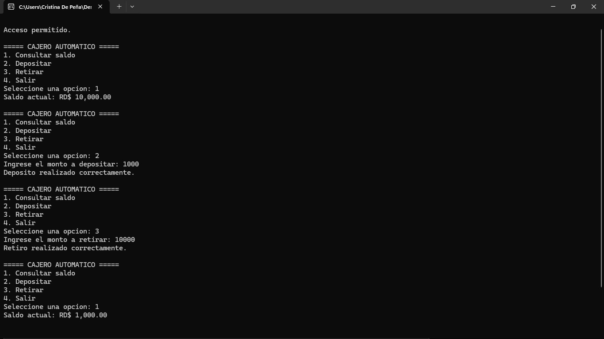
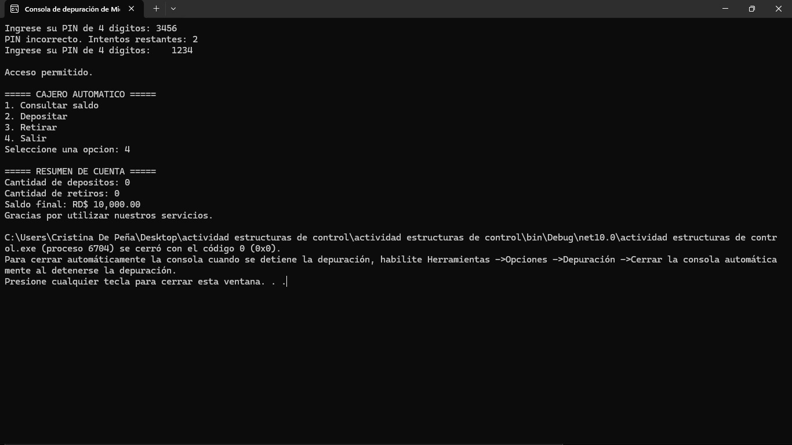
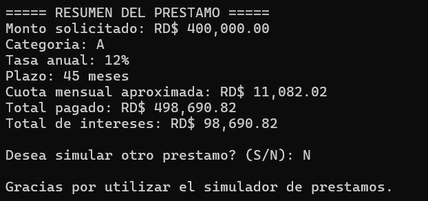
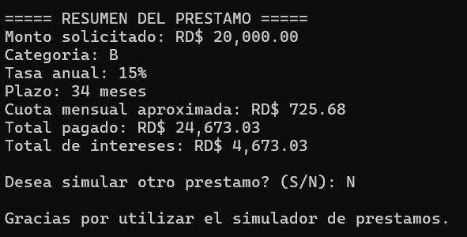
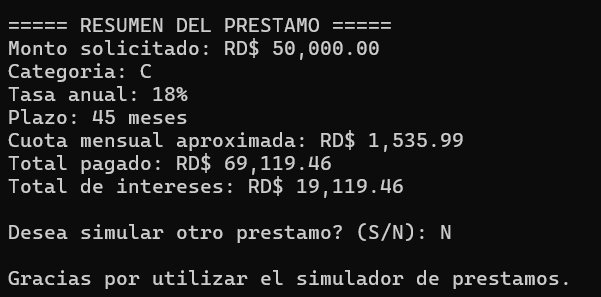

# Estructuras de-control
## Proyecto: Prototipo de Consola - Cooperativa 

## Integrantes del Equipo
- **Génesis Altagracia de la Cruz Perozo** | Matrícula: 26-SISN-2-051
- **Dalbert Yordani Hernández Alcántara** | Matrícula: 26-EISN-2-014
- **Emmanuel Javier Mercedes** | Matrícula: 26-EISN-2-023
- **Urihel Soto De Peña** | Matrícula: 26-EISN-2-032
- **Yokenddy Amparo Silvestre** | Matrícula: 26-EISN-2-002
- **Antoni Ramírez Mercedes** | Matrícula: 26-EISN-2-019

---

## Descripción del Proyecto
Este proyecto consiste en una aplicación de consola desarrollada en C# para la cooperativa **"Ahorro Seguro"**, orientada a modernizar dos procesos manuales mediante un menú principal interactivo que permite elegir entre dos funcionalidades clave:

1. **Cajero Automático:** Simulación de acceso seguro mediante PIN con validación de hasta 3 intentos, consulta de saldo, depósitos y retiros de efectivo con validación de múltiplos y límites de saldo.
2. **Simulador de Préstamo:** Cálculo de cuotas fijas mensuales y generación de una tabla de amortización detallada según la categoría del socio y su tasa de interés correspondiente.

---

## Ejercicio 1: Cajero Automático

### Datos de Entrada
- **PIN de seguridad:** Clave de 4 dígitos ingresada por el usuario.
- **Opción del menú del cajero:** Selección entre consultar saldo, depositar, retirar o salir.
- **Monto a depositar:** Cantidad numérica a ingresar a la cuenta.
- **Monto a retirar:** Cantidad numérica a extraer de la cuenta.

### Datos que Procesa
- **Validación de PIN:** Compara el PIN ingresado con el PIN maestro definido en el código (máximo 3 intentos; si se agotan, la cuenta se bloquea).
- **Gestión de Saldo (Saldo inicial: RD$ 10,000.00):**
  - **Depósito:** Valida que el monto ingresado sea mayor que cero y incrementa el saldo.
  - **Retiro:** Valida que el monto sea mayor que cero, no supere el saldo disponible y sea múltiplo exacto de RD$ 100.
- **Conteo de Transacciones:** Registra la cantidad total de depósitos y retiros exitosos realizados durante la sesión.

### Datos de Salida
- Confirmaciones de operaciones (depósitos/retiros) o mensajes explicativos en caso de error/validación.
- Saldo actual formateado en moneda.
- Resumen final al salir: cantidad de depósitos realizados, cantidad de retiros realizados y saldo final de la cuenta.

### Capturas de Pantalla - Cajero Automático
| Bloqueo por Intentos Fallidos | Menú, Consulta y Operaciones | Acceso Exitoso y Resumen Final |
| :---: | :---: | :---: |
|  |  |  |
| *Validación de seguridad y bloqueo tras agotar 3 intentos de PIN* | *Visualización del menú, consultas de saldo, depósitos y retiros* | *Acceso tras reintentar, salida del sistema y resumen de cuenta* |

---

## Ejercicio 2: Simulador de Préstamo

### Datos de Entrada
- **Monto del préstamo:** Valor entre RD$ 5,000.00 y RD$ 500,000.00.
- **Plazo:** Período entre 6 y 60 meses.
- **Categoría del socio:** Letra correspondiente a la categoría (`A`, `B` o `C`).
- **Confirmación de reinicio:** Respuesta (`S` / `N`) para indicar si desea realizar otra simulación.

### Datos que Procesa
- **Validación estricta de rangos:** Si el monto, el plazo o la categoría son inválidos, la aplicación vuelve a solicitar el dato utilizando bucles repetitivos y `int.TryParse` / `double.TryParse`.
- **Asignación de Tasa Anual e Interés Mensual ($i$):**
  - Categoría **A:** 12% anual ($i = 0.12 / 12$).
  - Categoría **B:** 15% anual ($i = 0.15 / 12$).
  - Categoría **C:** 18% anual ($i = 0.18 / 12$).
- **Cálculo de Cuota Fija Mensual:** Aplica la fórmula de amortización:
  $$\text{Cuota} = \text{Monto} \cdot \frac{i(1+i)^n}{(1+i)^n - 1}$$
- **Generación de la Tabla de Amortización:** Desglose mes a mes utilizando ciclos iterativos para calcular el interés del período, el abono a capital y el balance final remanente.

### Datos de Salida
- Tasa de interés aplicada según la categoría elegida.
- Tabla completa de amortización mostrando mes por mes: número de cuota, monto de la cuota, interés, abono a capital y saldo restante.
- Resumen acumulado de totales pagados (Total amortizado a capital e Intereses totales abonados).

### Capturas de Pantalla - Simulador de Préstamo
| Simulación Categoría A | Simulación Categoría B | Simulación Categoría C |
| :---: | :---: | :---: |
|  |  |  |
| *Préstamo de RD$ 400,000 a 45 meses (Tasa 12% - Cat. A)* | *Préstamo de RD$ 20,000 a 34 meses (Tasa 15% - Cat. B)* | *Préstamo de RD$ 50,000 a 45 meses (Tasa 18% - Cat. C)* |

---

## Tecnología Utilizada
- **Lenguaje de Programación:** C# (.NET Console Application).
- **Estructuras de Control:** `if`, `else if`, `else`, `switch`, `for`, `while` y `do-while`.
- **Manejo y Validación de Datos:** `int.TryParse()` / `double.TryParse()` para captura limpia de consola sin excepciones.
- **Control de Versiones:** Git y GitHub.
